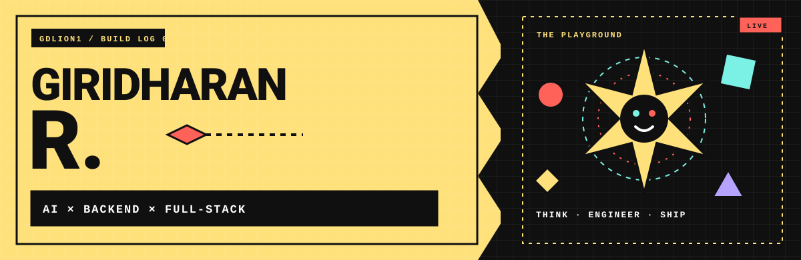
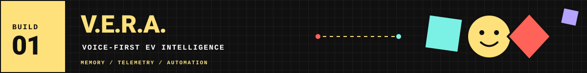
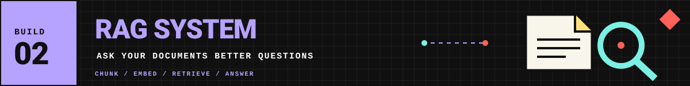
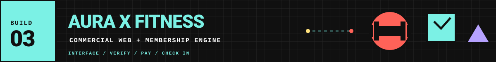
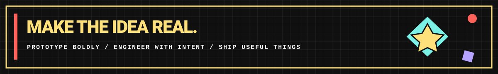

<!--
  GDlion1 / PROFILE README
  Art direction: Neo-brutalism × playful geometric fusion
  Palette: Signal yellow · ink black · electric cyan · punch coral · soft violet
  Keep README.md and the assets/ folder together in the root of the GDlion1/GDlion1 repository.
-->

  
   
  
  
  

  

> **I turn ambitious ideas into usable systems** — from voice-first AI agents and document-grounded answers to real-world web workflows. I work across **Generative AI, backend engineering, and full-stack development**.

  <table>
    <tr>
      <td align="center"><b>✳ INTELLIGENCE</b> LLMs · RAG · Embeddings · Agents</td>
      <td align="center"><b>⬢ INFRASTRUCTURE</b> Python · APIs · SQL · Events</td>
      <td align="center"><b>◈ EXPERIENCES</b> React · Workflows · Deployment</td>
    </tr>
  </table>
  📍 Bengaluru, India &nbsp;·&nbsp; B.E. Information Science & Engineering, 2026 &nbsp;·&nbsp; Open to early-career opportunities

---

## `01` — THE MAIN QUEST

I'm an Information Science & Engineering graduate who enjoys the seam between **AI capability and solid software engineering**. I care about what happens after the demo: data flow, API design, retrieval quality, persistent state, edge cases, and the details that make a product genuinely usable.

**My north star:** build intelligent features on top of dependable systems — then give people an interface that makes sense.

  
  

---

## `02` — THE FRONT ROW / TOP 03 BUILDS

**Voice-Enabled EV Intelligence & Personal AI Agent**  
`AGENTIC AI` `REAL-TIME EVENTS` `CONTEXTUAL MEMORY`

A voice-first assistant concept for EV contexts, combining LLM-based reasoning, vehicle telemetry, contextual memory, and event-driven driver assistance.

- Designed contextual-memory features for people, future messages, location-triggered reminders, routine learning, and proactive **“Before You Leave”** intelligence.
- Built an event-driven architecture around **FastAPI**, **MQTT**, GPS triggers, and deterministic Python services for vehicle events, charging states, schedules, geofencing, and automated actions.
- **Stack:** `Python` `FastAPI` `Gemini` `MQTT` `PostgreSQL` `WebRTC`

01 / VOICE · CONTEXT · AUTOMATION

---

**Retrieval-Augmented Generation (RAG) System**  
[↗ SOURCE CODE](https://github.com/GDlion1/RagSys) · `DOCUMENT AI` `VECTOR SEARCH`

A document question-answering app that retrieves relevant PDF content and uses it to produce context-grounded responses.

- Implemented PDF extraction, document chunking, **Gemini embeddings**, and **FAISS vector similarity search**.
- Connected retrieval results to Gemini-generated answers to keep responses grounded in uploaded document context.
- Built **FastAPI** REST endpoints and a **React** interface for uploads and interactive Q&A.
- **Stack:** `FastAPI` `React.js` `Gemini API` `FAISS` `LangChain` `PyPDF`

02 / INGEST → CHUNK → EMBED → RETRIEVE → ANSWER

---

**Commercial Web Platform & Membership Engine**  
[↗ SOURCE CODE](https://github.com/GDlion1/AURAXFITNESS) · [↗ LIVE WEBSITE](https://www.auraxfitness.in/) · `PRODUCT ENGINEERING`

A responsive web platform for a **2,500+ sq. ft. athletic facility**, combining a branded user experience with practical membership and entry workflows.

- Built a responsive platform with interactive facility previews and a custom visual design system.
- Developed student verification using **Google Apps Script webhooks** and base64 ID-card uploads to unlock discounted rates.
- Engineered a One Day Pass flow with UPI QR payments, mobile payment intents, verification-token generation, entry QR check-in, and WhatsApp receipt dispatch.
- **Stack:** `React 19` `Vite` `JavaScript` `CSS` `Google Apps Script` `Vercel` `Schema.org JSON-LD`

03 / INTERFACE · VERIFICATION · AUTOMATION

---

## `03` — SIDE QUESTS / TWO MORE BUILDS

<table>
  <tr>
    <td width="50%" valign="top">
      <h3>🚌 04 · Public Transport Accessibility</h3>
      
<b>Accessible mobility · Geospatial analysis · ML prototype</b>

      
Explores accessibility gaps in public transport for people with motor disabilities and investigates more accessible route options.

      <ul>
        <li>Analyses GTFS stops, route shapes, and schedules.</li>
        <li>Explores stop-level accessibility prediction with an LSTM approach.</li>
        <li>Uses OpenStreetMap networks with Dijkstra/A* routing and interactive map visualisation.</li>
      </ul>
      <b>STACK</b> Python · Pandas · GTFS · OSMnx · NetworkX · TensorFlow/Keras · Folium
    </td>
    <td width="50%" valign="top">
      <h3>⚡ 05 · Smart Power Distribution Simulator</h3>
      
<b>Full-stack simulation · Real-time events · Data systems</b>

      
A simulator project bringing together a web interface, backend services, persistent data, and real-time application events for a power-distribution workflow.

      <ul>
        <li>React interface with a Node.js backend.</li>
        <li>PostgreSQL for persistent data.</li>
        <li>Socket.IO for live communication and Docker in the toolchain.</li>
      </ul>
      <b>STACK</b> React · Node.js · PostgreSQL · Socket.IO · Docker
    </td>
  </tr>
</table>

---

## `04` — THE TOOLBOX / SELECTED STACK

  

| ZONE | TOOLS I HAVE WORKED WITH |
|:--|:--|
| **Languages** | Python · SQL · JavaScript (ES6+) |
| **Backend & APIs** | FastAPI · Django · RESTful APIs · API integration · Authentication & authorization |
| **Generative AI** | LLM integration · RAG · Prompt engineering · Embeddings · Vector search · Gemini API · LangChain · FAISS |
| **Frontend** | React.js · HTML5 · CSS3 · Responsive web development |
| **Data** | PostgreSQL · MySQL · SQLite · Database design · SQL queries |
| **Tools & delivery** | Git · GitHub · Docker · Vercel · Postman |
| **CS foundations** | Data Structures & Algorithms · OOP · DBMS · REST API design |

---

## `05` — ORIGIN STORY / EDUCATION

<table>
  <tr>
    <td valign="top" width="70%"><b>🎓 B.E. — Information Science & Engineering</b> AMC Engineering College, Bengaluru 2022–2026</td>
    <td valign="top" align="center">CGPA <h3>7.7 / 10</h3></td>
  </tr>
  <tr>
    <td valign="top"><b>📘 Pre-University Course</b> St. Joseph’s Pre-University College 2022</td>
    <td valign="top" align="center">PUC <h3>83%</h3></td>
  </tr>
</table>

**Certifications & learning**

- `HackerRank` — Python (Basic)
- `HackerRank` — SQL (Intermediate)
- `HackerRank` — Problem Solving (Intermediate)
- `Dhee Coding Lab` — Python Full Stack Development Internship (2026)

---

## `06` — GITHUB RADAR

  
  
    
  
    
  

  
<b>🧪 What I care about in a build</b>

   
  Useful abstractions over clever noise. Grounded AI answers over confident guesses. APIs that are easy to reason about. Interfaces that help people finish the task. And shipping the whole thing—not just the screenshot.

---

  
    
  
    
  <b>MAKE IT WORK. MAKE IT CLEAR. THEN MAKE IT WEIRD.</b>

